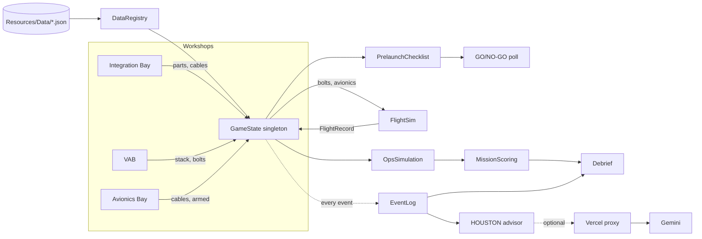
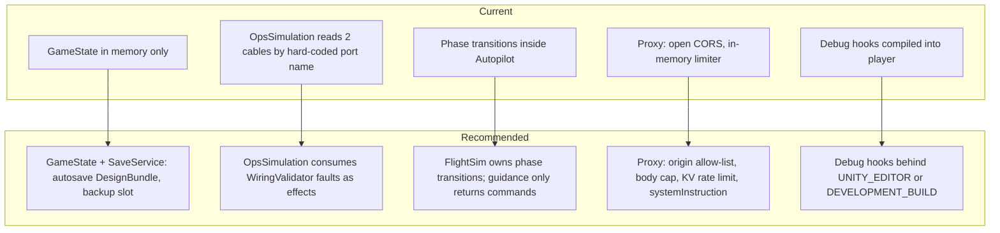

# Complete Project Audit — T-MINUS

Audit date: 14 November 2026. First audited at `f14062b`; updated for `8732835` (`main`).

**Changes since the first audit:** one commit by Ayaan Kashif (`8732835`). It fixes the black 3D view in WebGL. `SceneLook.cs` now falls back to plain rendering when URP's UberPost shader is unsupported, and post-processing shader stripping is turned off (in the URP global settings asset and forced by `WebGLBuilder.cs` on every web build). No gameplay, data, test, HOUSTON or proxy code changed, so every P0–P2 finding below still stands. Two new P3 items follow from the commit: A-34 and A-35.
Method: static read of the C# scripts, UXML/USS, JSON data, Editor tools, proxy and project settings, plus web research. **Nothing was executed**: Unity was not opened, tests were not run, the build was not played. Findings that depend on runtime behaviour are marked **(unverified at runtime)**. The "After" snippets are proposals and have not been compiled.

A longer feature-by-feature write-up with full feature specs is in `FEATURES_AUDIT_AND_ROADMAP.md`.

---

## Summary

The architecture is sound for a hackathon-built game: data-driven JSON, one assembly per module, a pure C# flight solver, 91 EditMode test methods and a causal event log. It does not need restructuring.

What needs work, most serious first:

1. **Simulation gaps that contradict the game's lesson.** CubeSat wiring faults, Safe/Arm and payload mass have no effect on the outcome.
2. **Two broken player paths.** Manual flight cannot lift off. The VAB's main button skips the checklist and crew poll.
3. **No persistence.** The build is lost on quit, and F9 or a Failure Lab job overwrites it.
4. **An open LLM proxy.** No authentication, no size limit, a rate limiter that does not hold on serverless.
5. **Scoring defects.** One score line is constant; counters leak between attempts; the leaderboard duplicates.
6. **Build hygiene.** An editor-only AI package is linked into the WebGL player through a workaround; no CI.

Issue count: 6 P0, 11 P1, 10 P2, 8 P3.

## Implementation status (updated after the fixes were written)

**Final status (14 November 2026): every item in this file now has code behind it, and every checklist box is ticked.** Some are smaller or different in form than first described, and all of it is untested. In plain terms:

- **Never run.** Nothing was compiled, tested or played: Unity was not available. The new EditMode and PlayMode tests are the first thing to run. Two of them are the most important: `FlightPhysicsTests.SaturnVReachesTheParkingOrbitWithPropellantLeftForTheMoonBurn` and `RehbarRocketClimbsToAboutOneHundredAndThirtyKilometresAndStopsThere` check that the C# flight agrees with the JavaScript port in `tools/sim` that the Moonshot and Rehbar-I tuning came from.
- **Different in form from what was first described:**
  - F18 (school licence) is the pilot offer the roadmap starts with (`tools/web/schools.html`); billing waits for what the pilot schools say.
  - F20's class dashboard is a browser page (`tools/web/teacher.html`) that listens to a class room on the public ntfy.sh relay (or reads pasted CSV); it is not our own server with accounts, so there is no login and results are kept only about 12 hours.
  - F25's live crew uses the free public relay ntfy.sh for votes (plus copy-and-paste codes), not a server of ours.
  - F15 has the text and a "Save picture" screenshot button, not a designed 1200x630 card; F24 jumps to the cause and can replay the failure in slow motion; F17's touch support is experimental.
  - A-24 moves plain on-screen text into `strings.json` (88 entries, by `tools/extract_strings.py`); text built at run time is still in the scripts.
  - A-11 is a release script (`tools/build_release.sh`) rather than a change to the development project, which keeps the AI packages for the Unity MCP tooling.
  - I12: the figures were checked against the Wikipedia articles the data cites; NASA's own Saturn V document could not be reached.
- **Needs a live service that was never contacted:** NASA Worldview imagery (F26), the ntfy.sh relay (F25), the HOUSTON proxy after its lock-down (A-05).
- **Open decisions for you:** push the commits; redeploy the proxy; set `ALLOWED_ORIGINS` and optionally `HOUSTON_CLIENT_TOKEN`.

**Important:** these changes were written without Unity or Blender on the machine, so **nothing has been compiled, tested or played.** Open the project, let Unity compile, run the EditMode tests (the new tests are in `OpsTests`, `AvionicsTests`, `FlightPhysicsTests`, `FailureLabTests` and `DesignValidatorTests`), then play the golden path, Judge Mode and a Failure Lab job. The log of what changed is in `docs/PROGRESS.md`, last entry.

Behaviour changes to know about before the demo: a rocket launched with Safe/Arm on SAFE now fails (arm it in the pre-launch checklist); the VAB's last button now goes to the checklist; the satellite's cable faults now cost science; the debrief no longer auto-advances (except in Judge Mode).

---

# PART A: PROJECT + ARCHITECTURE AUDIT

## A1. Stack

| Layer | Technology |
|---|---|
| Engine | Unity 6000.6.8f1, URP 17.6, C# |
| UI | UI Toolkit (5 UXML files, 10 USS files; most screens built in C#) |
| Input | Input System 1.20.1, keyboard and mouse only |
| Data | Newtonsoft JSON; 5 files in `Assets/_TMinus/Resources/Data/` |
| Persistence | PlayerPrefs (settings, leaderboard, HOUSTON ratings). No save game |
| AI | Vercel serverless function (`proxy/api/houston.ts`, Node 26) calling Gemini or an OpenAI-compatible API |
| Tests | Unity Test Framework, EditMode only, 16 files, 91 `[Test]` methods (+3 `[TestCase]` rows); team's latest run: 97 pass + 1 skip |
| Targets | Windows x64, WebGL (GitHub Pages) |
| CI | None |
| Size | 135 C# files under `Assets/_TMinus`, 16,738 lines; 8 scenes |

## A2. Data flow



## A3. Current vs recommended architecture

The module layout stays. The changes are three seams that are missing today.



## A4. Folder structure and code quality

**Good**
- `Assets/_TMinus/Scripts/<Module>` with one `.asmdef` each; dependencies point inward to `Core`.
- Pure logic is separated from MonoBehaviours (`BoltMath`, `WiringGraph`, `WiringValidator`, `FlightSim`, `SpacecraftBudget`, `AvionicsReport`). This is why the tests are fast and meaningful.
- Rules, parts, rockets and missions are data. Failure Lab jobs need no code.
- Scenes are generated by idempotent Editor menu commands.
- Files stay under 300 lines.

**Weak**
- UI is built imperatively in C# with inline styles (`JudgeMode.cs`, `FailureJobTracker.cs`, `SceneLabel.cs`). All player-facing text is hard-coded in C#, which blocks translation.
- `DebriefUI.cs` packs many statements per line and holds the leaderboard classes too. It is hard to review.
- Static `*Debug` hook classes for agent automation are compiled into the player in 11 files.
- Some rule logic is hard-coded despite the "data-driven" rule: `OpsSimulation.cs:25-31` uses the literal ids `dep_switch`, `BATT`, `BATT_IN`, `BATT_OUT`; `FlightRuntime.cs:20` uses `floodwatch_1`.

## A5. Issues

Priority: P0 = fix before the next public demo; P1 = this sprint; P2 = next; P3 = when convenient.
Effort: S ≤ half a day, M = 1–3 days, L = a week or more.

### P0

#### A-01 CubeSat wiring faults have no effect on operations
- **File + Line:** `Assets/_TMinus/Scripts/Mission/OpsSimulation.cs:25-32, 73-74`; `Core/SpacecraftBudget.cs:64-158`
- **Problem:** Operations check only battery → switch → EPS. Generation, imaging and downlink are computed from the parts list alone.
- **Why It Matters:** A satellite with no antenna cable returns the full image count. Judge Mode's first act is "fix the missing antenna cable"; skipping that fix changes nothing but 2 score points.
- **Fix:**

BEFORE (`OpsSimulation.cs:73`)
```csharp
double rate = state.Data.GetPart(budget.radioId)?.Spec("dataRateKbps") ?? 0;
```
AFTER
```csharp
var faults = PrelaunchChecklist.SpacecraftWiringFaults(PrelaunchChecklist.From(state));
bool Broken(string instanceId) => faults.Any(f => f.severity >= Severity.Fault && f.device == instanceId);
var radio = state.Spacecraft.parts.FirstOrDefault(p => p.partId == budget.radioId);
bool radioOk = radio != null && !Broken(radio.instanceId);
double rate = radioOk ? state.Data.GetPart(budget.radioId)?.Spec("dataRateKbps") ?? 0 : 0;
if (!radioOk) Fail(report, state, "no_downlink", "The radio is not fully wired; nothing reached the ground.", radio?.instanceId);
```
Apply the same pattern to the camera (0 images), the solar input (0 W) and short circuit or reversed polarity (dead on deployment). Add one OpsTests case per effect.
- **Impact:** High. **Effort:** M. **Priority:** P0.

#### A-02 Manual flight cannot leave the pad
- **File + Line:** `Flight/FlightGuidance.cs:26-34, 80-87`; `Flight/FlightSim.cs:141-147`
- **Problem:** `SetPhase` is called only inside `Autopilot`. In manual mode the phase stays `Pad`, and `HoldDownOnPad` pins the rocket every step. Switching to manual in flight means `Orbit` can never be reached, so the CubeSat never deploys.
- **Why It Matters:** The HUD offers the toggle on every flight and the README documents the keys.
- **Fix:**

BEFORE (`FlightSim.Step`)
```csharp
GuidanceCommand command = Options.autopilot ? FlightGuidance.Autopilot(this) : FlightGuidance.Manual(this);
```
AFTER
```csharp
GuidanceCommand command = Options.autopilot ? FlightGuidance.Autopilot(this) : FlightGuidance.Manual(this);
UpdatePhase(command);   // shared by both modes

void UpdatePhase(GuidanceCommand c)
{
    var s = Vehicle.stages[Math.Max(0, Math.Min(_stageIndex, Vehicle.stages.Count - 1))];
    if (Phase == FlightPhase.Pad && _stageIgnited &&
        s.thrustVacN * s.ispSeaLevel / Math.Max(1, s.ispVac) * c.throttle > _mass * FlightConstants.G0)
        SetPhase(FlightPhase.Ascent);
    if (!Options.autopilot && Phase != FlightPhase.Pad)
    {
        var o = OrbitElements.From(_position, _velocity);
        if (o.bound && o.periapsisM - FlightConstants.EarthRadiusM >= 150000) SetPhase(FlightPhase.Orbit);
    }
}
```
Add a test: manual, throttle 1, pitch 90 → altitude > 1 km at T+30 s. Short-term alternative: hide the toggle (`FlightHud.cs:49`).
- **Impact:** High. **Effort:** M (S to hide). **Priority:** P0.

#### A-03 The VAB's main button skips the checklist and crew poll
- **File + Line:** `Assembly/VabUI.cs:63`; `Core/SceneFlow.cs:29-33`; button text in `UI/UXML/VAB.uxml:16`
- **Problem:** "To launch pad >" calls `SceneFlow.Next`, which loads Flight. The checklist, RBF pin, arming and poll live in the MissionBriefing scene.
- **Why It Matters:** The player launches with the pin in, the debrief says the satellite never powered on, and `knownFailures` is empty so decision quality scores 100%.
- **Fix:**

BEFORE
```csharp
Bind("btn-next", SceneFlow.Next);
```
AFTER
```csharp
Bind("btn-next", () => { DemoHooks.PendingBriefingPanel = "checklist"; SceneFlow.Load(SceneNames.MissionBriefing); });
// BriefingUI.Start(): if (DemoHooks.PendingBriefingPanel == "checklist") { ShowBriefing(); ShowChecklist(); }
```
- **Impact:** High. **Effort:** S. **Priority:** P0.

#### A-04 No save game; demo modes overwrite the build
- **File + Line:** `Core/GameState.cs:17-26`; `Mission/JudgeMode.cs:81, 186-193`; `Mission/FailureLab.cs:53`
- **Problem:** All design state is in memory. F9 (active in every scene) and "Take the job" call `DemoBuilds.Apply`, replacing the build with no prompt.
- **Why It Matters:** Up to an hour of work is lost to a quit, a browser refresh or one key.
- **Fix:**

AFTER (new `Core/SaveService.cs`, sketch)
```csharp
public static class SaveService
{
    const string Key = "tminus.save.v1", Backup = "tminus.save.backup.v1";
    public static void Save(GameState s) { PlayerPrefs.SetString(Key, DesignCode.Encode(DesignCode.FromState(s))); PlayerPrefs.Save(); }
    public static bool TryLoad(GameState s) =>
        DesignCode.TryDecode(PlayerPrefs.GetString(Key, ""), out var b, out _) && DesignValidator.Clean(b, s.Data) && Apply(b, s);
    public static void BackupCurrent(GameState s) => PlayerPrefs.SetString(Backup, DesignCode.Encode(DesignCode.FromState(s)));
    public static void RestoreBackup(GameState s) { /* decode Backup, Apply */ }
}
```
Call `Save` from `BayController.Save`, `RocketView.SaveTo` callers, `BoltJointState.SaveTo` callers and the avionics bench `Changed` handler (debounced). Call `BackupCurrent` at the top of `JudgeMode.Start` and `FailureLab.Begin`; restore in `JudgeMode.Exit` and after the job debrief. Add a confirm dialog to both entry points.
- **Impact:** High. **Effort:** M. **Priority:** P0.

#### A-05 HOUSTON proxy is an open LLM endpoint
- **File + Line:** `proxy/api/houston.ts:3-20, 27, 39-49, 61-64, 92`; URL published in `proxy/README.md:87`
- **Problem:**
  - CORS is `*` and there is no authentication.
  - `question` and `packet` have no size or type validation.
  - The rate limiter is a module-level `Map`; it is per-instance and cleared on cold start.
  - `GET ?diag=models` is public.
  - For Gemini, the system prompt is concatenated into the user turn, which makes it easy to override.
- **Why It Matters:** Anyone can spend the team's API quota or use the endpoint as a general chatbot. The audience is children: there are no explicit safety settings and no notice in the UI that questions go to a third party.
- **Fix:**

BEFORE
```ts
res.setHeader('Access-Control-Allow-Origin', '*');
...
const { packet, question } = req.body || {};
if (!question && !packet) return res.status(400).json({ error: 'Missing packet or question' });
```
AFTER
```ts
const ALLOWED = new Set(['https://ayaan-kashif.github.io']);        // + '' for desktop builds, gated by a build token
const origin = (req.headers.origin as string) || '';
if (origin && !ALLOWED.has(origin)) return res.status(403).json({ error: 'Forbidden' });
res.setHeader('Access-Control-Allow-Origin', origin || 'null');
res.setHeader('Vary', 'Origin');
...
const { packet, question } = req.body || {};
const q = typeof question === 'string' ? question.slice(0, 300) : '';
const p = JSON.stringify(packet ?? {});
if (!q || p.length > 8000) return res.status(400).json({ error: 'Bad request' });
```
Also:
- Move the limiter to Vercel KV / Upstash (`INCR` with a 60 s expiry per IP) and add a daily global cap.
- Delete the `diag=models` branch.
- Send the prompt as `systemInstruction` and set `safetySettings`.
- Stop returning `upstreamReason`.
- Add one line under the HOUSTON input: "Questions you type are sent to an AI service. Don't type personal details."
- **Impact:** High. **Effort:** M. **Priority:** P0.

#### A-06 Urdu answers have no font support **(unverified at runtime)**
- **File + Line:** `Assets/_TMinus/Resources/UI/TMinusPanelSettings.asset` (`textSettings: {fileID: 0}`); no `.ttf`/`.otf` in the repository; option offered at `UI/MenuPanels.cs:76`
- **Problem:** Urdu needs Arabic-script glyphs, right-to-left layout and contextual joining. The project ships no font and no text settings; WebGL has no OS fonts to fall back to.
- **Why It Matters:** "English/Urdu HOUSTON support" is in the pitch script (`docs/SUBMISSION.md:20`). If it renders as boxes or disjoint letters in front of judges, it reads as a false claim.
- **Fix:** Test first in the WebGL build. If broken: add an OFL Urdu font (Noto Naskh Arabic or Noto Nastaliq Urdu) as a font asset with dynamic atlas, set it as a fallback in a `PanelTextSettings` asset, and enable Unity 6's Advanced Text Generator on the HOUSTON message labels for shaping and RTL. Until then, label the option "Urdu (experimental)".
- **Impact:** High for the pitch. **Effort:** S to test, M to fix. **Priority:** P0.

### P1

#### A-07 Safe/Arm has no flight consequence
- **File + Line:** `Mission/PrelaunchChecklist.cs:125-126` (text); no reference to `armed` under `Scripts/Flight/`
- **Problem:** The checklist says "Still SAFE: nothing can ignite or separate." The flight ignores the flag.
- **Fix:**

BEFORE (`AvionicsReport.cs:30`)
```csharp
public bool S1IgnitionOk => PowerOk && !Has("no_ignition");
```
AFTER
```csharp
public bool S1IgnitionOk => PowerOk && armed && !Has("no_ignition");
public string CauseId(string consequence) =>
    consequence == "no_ignition" && !armed ? "av_safe_arm" : First(consequence)?.linkId;
```
`AvionicsReport.Perfect()` must set `armed = true`. Update `AvionicsTests` and `DemoBuilds` callers that fly without `padReady`.
- **Impact:** Medium. **Effort:** S. **Priority:** P1.

#### A-08 Scoring: constant team score, counters never reset
- **File + Line:** `Mission/Scoring.cs:23-28`; `Mission/PrelaunchChecklist.cs:152-162`; `Core/Designs.cs:86, 119`
- **Problem:** "Team roles" is distinct roles ÷ 4, and `AssignRoles` always assigns four. `hintsUsed` and `noGoRounds` accumulate for the whole session.
- **Fix:**

BEFORE
```csharp
Add(score, "crew", "Team roles", w.collaboration, Math.Min(1, s.Crew.Select(c => c.role).Distinct().Count() / 4.0));
```
AFTER
```csharp
// Roles that actually voted in the final poll, and whose owner fixed at least one of their own FAILs or had none.
int acted = s.Launch.poll.Select(p => p.Split(':')[0]).Distinct().Count();
Add(score, "crew", "Team roles", w.collaboration, acted / 4.0);
```
And in `BriefingUI.StartPoll`: store `hintsAtPoll`; in `DebriefDebug.ResetRun` and when leaving the debrief via "Redesign": `s.Settings.hintsUsed = new int[3]; s.Launch = new LaunchRecord();`.
- **Impact:** Medium. **Effort:** S. **Priority:** P1.

#### A-09 Leaderboard duplicates on every click
- **File + Line:** `Mission/DebriefUI.cs:104-109`
- **Fix:**

BEFORE
```csharp
var rows = Leaderboard.Load(); rows.Add(new LeaderboardEntry { name = "Player", score = DebriefDebug.LastScore.total, ... });
```
AFTER
```csharp
var rows = Leaderboard.Load();
if (!_savedToBoard)
{
    _savedToBoard = true;
    string who = string.Join(" + ", GameState.Instance.Crew.Select(c => c.name).Distinct());
    rows.Add(new LeaderboardEntry { name = who, score = DebriefDebug.LastScore.total, code = ... });
}
```
- **Impact:** Low. **Effort:** S. **Priority:** P1.

#### A-10 Design codes are applied without validation
- **File + Line:** `Core/DesignCode.cs:55-59, 72-77`
- **Problem:** A decoded bundle is assigned straight into `GameState`. Null lists (`"parts": null`), unknown part or rocket ids, out-of-range bolt indices and locked mission ids all pass.
- **Why It Matters:** Codes are meant to be pasted from other people. A bad one can throw in later scenes; a crafted one loads a locked mission.
- **Fix:** add `DesignValidator.Clean(bundle, data)` that replaces null lists, drops entries whose ids are not in `DataRegistry`, clamps numbers, rejects locked missions, and returns a count of dropped items for a toast. Call it in `TryDecode`.
- **Impact:** Medium. **Effort:** S. **Priority:** P1.

#### A-11 Editor-only AI package is linked into the WebGL player
- **File + Line:** `Packages/manifest.json` (`com.unity.ai.assistant` 2.21.0-pre.2, `com.unity.ai.inference`); `Editor/WebGLBuilder.cs:31-35`; `Plugins/WebGL/EmvalCompat.jslib`
- **Problem:** A pre-release editor tool forces `-lembind` and a stub `.jslib` so the web build links. `link.xml` preserves every game assembly and stripping is Minimal.
- **Why It Matters:** A fragile build and a larger download (about 24–26 MB). A package update can break the web build with no code change.
- **Fix:** remove both AI packages from `manifest.json` on the release branch (keep them on a tooling branch), then delete the embind argument and the jslib. Also remove unused modules (`vehicles`, `terrain`, `cloth`, `xr`, `video`, `wind`, `tilemap`, `umbra`, `unityanalytics`). In `link.xml`, preserve only `TMinus.Core.Data` and the design classes, then raise stripping to Low and compare size.
- **Impact:** Medium. **Effort:** M. **Priority:** P1.

#### A-12 No CI
- **File + Line:** repository root (no `.github/`)
- **Problem:** Tests run only when someone opens the Editor. Three AI agents and humans commit to `main`.
- **Fix:** add a GitHub Actions workflow with GameCI `unity-test-runner` for EditMode on every push, plus `npm run typecheck` in `proxy/`. Add a WebGL build job on tags.
- **Impact:** Medium. **Effort:** S. **Priority:** P1.

#### A-13 Two countdowns and an auto-advancing end card
- **File + Line:** `Mission/BriefingUI.Pad.cs:102-128`; `Flight/FlightHud.cs:89-102`; `Flight/FlightController.cs:101, 205`
- **Problem:** The briefing counts to "LIFTOFF!", then Flight shows a hold and counts again. After the flight, `_endTimer` loads the debrief in 7–9 s regardless of the player.
- **Fix:** in the briefing, replace the countdown with "All roles GO — proceed to the pad" and load Flight. Keep the countdown and pitch-kick choice in Flight. Remove `_endTimer` (Judge Mode already drives its own transitions).
- **Impact:** Medium. **Effort:** S. **Priority:** P1.

#### A-14 Flight uses fixed inputs instead of the player's design
- **File + Line:** `Flight/FlightRuntime.cs:20-24`; no read of `Vehicle.parts` under `Scripts/Flight/`
- **Problem:** Payload is always `referencePayloadKg` (150 kg). The mission is hard-coded to `floodwatch_1`. The rocket is built from data, so an unstacked rocket flies as a complete one and fails with a joint message.
- **Fix:** pass the mission id and the CubeSat mass in (payload = dispenser ballast + `SpacecraftReport.massKg`). In `FlightController.EnsureInitialized`, if the stack is incomplete, abort on the pad with "The rocket is not fully assembled" and cause `rk_stack`.
- **Impact:** Medium. **Effort:** S. **Priority:** P1.

#### A-15 Debrief prints operations events in flight format
- **File + Line:** `Mission/DebriefUI.cs:49`
- **Fix:**

BEFORE
```csharp
page.Add(new Label($"T+{e.time:0}s  {e.system}/{e.code}: {e.message}" + ...));
```
AFTER
```csharp
string when = e.system == "operations"
    ? $"Day {Math.Max(0, (int)Math.Round((e.time - s.Flight.flightTimeS) / 86400))}"
    : $"T+{e.time:0} s";
page.Add(new Label($"{when}  {e.message}" + (string.IsNullOrEmpty(e.causeId) ? "" : $"  ← {e.causeId}")));
```
- **Impact:** Low. **Effort:** S. **Priority:** P1.

#### A-16 WebGL-specific UI errors
- **File + Line:** `UI/MainMenuController.cs:61-68` (Quit is a no-op in browsers); `Mission/BriefingUI.cs:201-203` (clipboard toast); `UI/MenuPanels.cs:79` (fullscreen toggle)
- **Fix:** hide Quit and Fullscreen when `Application.platform == RuntimePlatform.WebGLPlayer`. In the briefing, reuse the debrief's wording ("select and copy") on WebGL.
- **Impact:** Low. **Effort:** S. **Priority:** P1.

#### A-17 README sourcing claim does not match the data
- **File + Line:** `README.md:78`, `CREDITS.md:8` (NASA Saturn V News Reference) vs `Resources/Data/rockets.json:91, 117, 137, 158` and `parts.json:196-200` (Wikipedia); three stages carry `needsReview: true`; 25 of 28 Space Guide sources are Wikipedia
- **Why It Matters:** "Validity" is one of the five Space Apps judging criteria.
- **Fix:** check each Saturn V number against the NASA reference, change `source` to the NASA URL where it matches, and clear `needsReview`. Or change the README sentence to describe the real sources.
- **Impact:** Medium. **Effort:** S. **Priority:** P1.

### P2

| ID | File + Line | Problem | Fix | Effort |
|---|---|---|---|---|
| A-18 | `Flight/FlightSim.cs:135`; `FlightSim.Telemetry.cs:14` | A `TelemetrySample` with a new `double[]` is allocated every 0.05 s of sim time and kept for the whole flight (tens of thousands of objects; GC pressure in WebGL) | Record at 5 Hz, reuse the propellant array, keep only the last sample for the HUD | S |
| A-19 | `Flight/FlightGuidance.cs:54-73` | If stage 2 runs dry in a stable orbit below target − 10 km, no phase is terminal and the flight never ends **(unverified at runtime)** | End with outcome "Orbit (off target)" when propellant is 0 and periapsis is above 150 km | S |
| A-20 | `Flight/FlightController.cs:86-99`; `FlightController.Initialization.cs:52-94` | If initialisation throws, `Update` dereferences a null `Sim` every frame | Guard `Update` with `if (!_initialized) return;` and show an error panel | S |
| A-21 | 11 files with `static class *Debug` (for example `Mission/DemoBuilds.cs:81`, `Flight/FlightDebug.cs`, `UI/UiDebug.cs`) | Automation hooks ship in the player | Wrap in `#if UNITY_EDITOR \|\| DEVELOPMENT_BUILD` | S |
| A-22 | `Assembly/AssemblyController.cs:43-47` | Undo/redo exists only for stacking | Shared command stack for cables, bolts fitted/removed, CubeSat parts | M |
| A-23 | `Mission/OpsSimulation.cs:40-60`; `missions.json:32-36` | "Random events" are fixed days; `seed` is unused | Derive event days from `seed` + attempt number | S |
| A-24 | All UI classes | Player text is hard-coded in C# | Move strings to a JSON table keyed by id; needed before any UI translation | L |
| A-25 | `Houston/HoustonPanel.Actions.cs:179-184`; `Houston/HoustonLLMClient.cs:127` | Rating counters are written and never read; `AskDebrief` is never called | Show the ratio in Settings or remove the buttons; wire or delete `AskDebrief` | S |
| A-26 | `Core/AudioFx.cs` | Eight generated blips; no engine sound or music | Add a thrust-driven loop and a volume split | S |
| A-27 | No PlayMode tests | Scene wiring, UI bindings and the scene-to-scene flow are untested; A-03 would have been caught | One PlayMode smoke test: load each scene, assert no errors; one golden-path test using the existing debug hooks | M |

### P3

| ID | File + Line | Problem | Fix | Effort |
|---|---|---|---|---|
| A-28 | `Core/SceneFlow.cs:20-21` | `SceneNames.All` omits `AvionicsBay`, though it is in Build Settings | Add it, or delete the unused array | S |
| A-29 | `Assets/Scenes/SampleScene.unity`, `Assets/TutorialInfo/` | Unity template leftovers | Delete | S |
| A-30 | `proxy/README.md:11, 34, 86`; `proxy/houston_system_prompt.txt` | Docs say 300 tokens and `gemini-flash-latest`; code uses 1500 and `gemini-3.5-flash-lite`. The `.txt` prompt differs from the embedded one | Update the README; generate the embedded prompt from the `.txt` at build, or delete the `.txt` | S |
| A-31 | `Mission/RewardGallery.cs:66` | Downsampled textures are cached for the process lifetime | Destroy on scene unload | S |
| A-32 | `Mission/DebriefUI.cs` | Dense one-line style; leaderboard types in the UI file | Reformat; move `Leaderboard` to its own file | S |
| A-33 | `Mission/OpsSimulation.cs:25-31` | Hard-coded part and port ids | Read the path from `rules.json` `inlineRules` | S |
| A-34 | `Editor/WebGLBuilder.cs:36-46` (new in `8732835`) | The build command edits and saves a project settings asset as a side effect, matching any boolean whose name starts with `m_StripUnusedPostProcessing`. The asset is already committed with the flags off, so this only matters if someone turns them back on | Keep the asset as the single source of truth: log a warning and stop the build if stripping is on, instead of silently changing it | S |
| A-35 | `Settings/UniversalRenderPipelineGlobalSettings.asset:22, 29` (new in `8732835`) | Post-processing stripping is off for every platform, not only WebGL | Compare Windows and WebGL build sizes before and after; if the cost is significant, re-enable stripping and keep the needed variants with a shader variant collection | S |

## A6. Security summary

| Area | State |
|---|---|
| Secrets in the repository | None found. `houston.config.json` is git-ignored and was never committed |
| API key handling | Server-side only, sent in a header. Good |
| Proxy access control | **Open** (A-05) |
| Untrusted input | Design codes have a size cap but no content validation (A-10) |
| Children's data | Free-text questions go to a third-party AI with no notice (A-05) |
| Editor automation | `AgentBridge` runs menu items named in `Temp/*.flag` files. Editor-only and local; acceptable for development |

## A7. Performance summary

- No measurements were taken. The items below are from reading the code.
- Flight allocates per sim step (A-18) and runs LINQ in `Update` (`FlightController.cs:96`).
- Label positions are recomputed every frame in the Bay, VAB and Avionics Bay; fine at this scale.
- `Resources.LoadAll` at boot loads all JSON synchronously; fine at this size.
- WebGL download is about 24–26 MB by the project's own notes; A-11 is the main lever.
- Since `8732835`, post-processing shader variants are no longer stripped. That fixed the black screen but likely increases build size and shader load time; not measured (A-35).
- Browsers without UberPost support now render without bloom, grading or SMAA. This is the right fallback; the 3D view will look flatter on those machines.

## A8. Testing summary

- 91 EditMode `[Test]` methods in 16 files (the team reports 97 pass + 1 intentional skip in its latest run) cover data integrity, bolt maths, wiring, budgets, checklist, avionics, flight physics, operations, rewards, Failure Lab and the HOUSTON advisor.
- Not covered: UI, scene transitions, manual flight, save/load (does not exist), the proxy.
- No CI (A-12).

## A9. Scalability

The data model scales to more parts and missions without code. The limits are elsewhere: `PrelaunchChecklist`, `OpsSimulation` and `Scoring` assume a 3U imaging CubeSat (camera, images, downlink). Moonshot and Rehbar-I need a per-payload-type strategy (an `IMissionModel` with `BuildChecklist`, `RunOperations`, `Score`) before they can be added cleanly.

---

# PART B: FEATURES AUDIT

Statuses: Complete / Half-Built / Broken / Missing States.

| Feature | Status | Gaps (CRUD, validation, states) |
|---|---|---|
| Main menu | Complete | No Continue; Quit dead in WebGL |
| Mission select | Half-Built | 1 playable mission; 2 "Coming next"; 3 cards bounce back to the menu |
| Briefing: orbit, rocket, site | Complete | Criteria never ticked later |
| Crew 1–4 | Half-Built | Create and rename only; hot-seat; no effect outside the poll |
| Design code | Missing States | No validation; wrong success toast in WebGL; no error detail |
| Integration Bay parts | Complete | Create/remove; no undo, no confirm |
| FlatSat wiring | Complete | Create/remove; no undo |
| Wiring validator | Complete | — |
| Multimeter | Complete | — |
| Budgets panel | Complete | — |
| RBF pin | Complete | — |
| VAB stacking | Complete | Has undo/redo |
| Bolting | Complete | No undo for fit/remove |
| Inspect / exploded / X-ray | Complete | — |
| Avionics Bay | Complete | — |
| Safe/Arm | Broken | No flight consequence (A-07) |
| Checklist | Missing States | Skippable from the VAB (A-03) |
| GO/NO-GO poll | Complete | — |
| Countdown | Half-Built | Duplicated (A-13) |
| Flight physics | Complete | Fixed payload (A-14) |
| Autopilot | Complete | Possible stall (A-19) |
| Manual flight | Broken | A-02 |
| Flight HUD | Missing States | No pause, no menu, no error state if init fails |
| Operations sim | Half-Built | Wiring ignored (A-01); events fixed (A-23) |
| Scoring | Half-Built | A-08 |
| Debrief | Missing States | A-15; no criteria; no menu button |
| Landsat reward | Complete | — |
| Design compare | Complete | — |
| Leaderboard | Broken | A-09; no delete, no names |
| HOUSTON advisor | Complete | — |
| HOUSTON AI | Half-Built | A-05, A-06; no loading timeout message beyond "[offline]" |
| Failure Lab (2 jobs) | Half-Built | Overwrites build (A-04); scores not saved |
| Judge Mode | Half-Built | Overwrites build (A-04) |
| Space Guide | Complete | Read-only; search by title and short text only |
| Settings | Half-Built | 4 options; no graphics, text size or reset |
| Sandbox | Half-Built | Scene picker only |
| Audio | Half-Built | A-26 |
| Save / load | **Missing** | A-04 |
| Tutorial | **Missing** | Two toasts only |
| Pause menu | **Missing** | — |

**TODOs and placeholders found:** `AudioFx.cs:8` (replace sounds, "Prompt 17"); `AskDebrief` unused; rating counters unread; unused mission fields `seed`, `storyCard`, `targetApogeeKm`, `parkingOrbitKm`, `requiredDeltaVLeftMs`; `UI/SceneLabel.cs` stub banner; `SampleScene` and `TutorialInfo`.

---

# PART C: WEB RESEARCH + COMPETITOR COMPARISON

Competitors: **Kerbal Space Program (KSP)**, **Juno: New Origins**, **Spaceflight Simulator (SFS)**, **Mars Horizon**, **PC Building Simulator 2 (PCBS2)**. Entries for competitors come from store pages, reviews and aggregators, not from hands-on play; cells marked "—" were not researched.

### Architecture
| | T-MINUS | KSP | Juno | SFS | Mars Horizon | PCBS2 |
|---|---|---|---|---|---|---|
| Engine | Unity 6 | Unity | Unity | Unity | — | Unity |
| Physics | Custom 2D double-precision | 3D rigid-body + patched conics | 3D | 2D | None (turn-based) | n/a |
| Data-driven content | Yes (JSON) | Yes (part configs, mods) | Yes (XML crafts, mods) | Blueprints | — | — |
| Browser build | Yes | No | No | No | No | No |
| Backend | Optional LLM proxy | None needed | Craft gallery | Sharing | None | None |

### Features
| | T-MINUS | KSP | Juno | SFS | Mars Horizon | PCBS2 |
|---|---|---|---|---|---|---|
| Bolt and cable assembly | **Yes** | No | No | No | No | Yes |
| Subsystem budgets | **Yes** | Partial | Partial | No | Abstract | n/a |
| Causal failure debrief | **Yes** | No | No | No | Partial | Yes |
| Manual flight | Broken | Yes | Yes | Yes | No | n/a |
| Tutorials | No | Yes | Yes | Minimal | Yes | Yes |
| Career / progression | No | Yes | Yes | No | Yes | Yes (30 h) |
| Save game | No | Yes | Yes | Yes | Yes | Yes |
| Build sharing | Text code | Files | Gallery | Blueprints | No | No |
| Assistant | **HOUSTON** | No | No | No | No | No |

### Security
| | T-MINUS | Others |
|---|---|---|
| Online surface | One LLM proxy, currently open | Mostly offline or platform services |
| Children's data | Free text to third-party AI, no notice | Not applicable (no AI chat) |
| User content | Design codes, unvalidated | Platform-moderated galleries (Juno) |

### Performance
| | T-MINUS | Others |
|---|---|---|
| Download | ~26 MB in a browser | Multi-GB installs (KSP, PCBS2); mobile app (SFS, Juno) |
| Hardware | Should run on school laptops; no quality setting | KSP is CPU-heavy with large craft |
| Measured | Not measured in this audit | — |

### UX
| | T-MINUS | KSP | Juno | SFS | Mars Horizon | PCBS2 |
|---|---|---|---|---|---|---|
| First 10 minutes | No guidance | Tutorials exist; early game is the top complaint | Interactive tutorials; called thin by an aggregator | Trial and error | Guided | First career jobs are the tutorial |
| Explains "why" | Every number, plus Space Guide | KSPedia | Limited | No | Some history | Part descriptions |
| Touch / mobile | No | No | Yes | Yes | Console | No |
| Main complaint | — | Learning cliff | Career mode | Paid part packs | Repetitive mini-games | Some realism gaps |

### What top projects do that T-MINUS does not
1. Persist progress.
2. Teach the first session step by step.
3. Give a reason to return: career, contracts, unlocks.
4. Let the player fly by hand.
5. Offer a gallery of shared builds.
6. Run on touch devices.
7. Outside this genre, classroom games (Blooket, Legends of Learning, Minecraft Education) provide class codes and teacher dashboards.

### What T-MINUS does that none of them do
Trace a mission loss to a specific bolt or cable, and have an assistant that explains it. This answers KSP's best-known weakness and should be the centre of the pitch.

Sources: see the list at the end of `FEATURES_AUDIT_AND_ROADMAP.md`. The official 2026 challenge page could not be loaded, so the exact challenge wording was not verified. Space Apps judges on Impact, Creativity, Validity, Relevance and Presentation ([Judging & Awards Guide](https://www.spaceappschallenge.org/resources/judging-awards-guide)).

---

# PART D: NEW FEATURES SUGGESTIONS

Full specs for each (step-by-step flow, screens, backend) are in `FEATURES_AUDIT_AND_ROADMAP.md` section 5. Summary:

| ID | Feature | Group | Problem | User Story | Flow (short) | Screens | Backend / DB | Impact | Effort | Priority |
|---|---|---|---|---|---|---|---|---|---|---|
| F1 | Autosave and Continue | Must-Have | Build lost on quit, refresh, F9 | As a student I want my build kept so I can finish over several lessons | Save `DesignBundle` on change → Continue row in menu → backup before demos | Menu row, confirm dialog | PlayerPrefs | High | S | P0 |
| F2 | Guided first build | Must-Have | No tutorial | As a new player I want to be walked through my first satellite | Instruction bar fed by `NextStep` → target pulses → 5 steps → hand over to HOUSTON | Overlay bar | Local flag | High | M | P0 |
| F3 | Wiring faults change the mission | Must-Have | Unplugged cables do nothing | As a player I want a missing antenna cable to silence the satellite | Validate wiring before ops → map faults to effects → log with cause → show in debrief | None new | None | High | M | P0 |
| F4 | Pause menu | Must-Have | Cannot pause or leave Flight | As a teacher I want to pause at max-Q to explain it | Esc → Resume / Controls / Settings / Restart / Menu; sim frozen | Overlay | None | Medium | S | P1 |
| F5 | Success criteria in debrief | Must-Have | Goals are never marked | As a player I want each goal ticked or crossed | List criteria with ✓/✗ and measured value | Debrief card | None | Medium | S | P1 |
| F6 | Controls overlay | UX | Keys only in README | As a player I want the controls on one key | F1 or "?" → per-scene card | Overlay | None | Medium | S | P1 |
| F7 | Undo everywhere | UX | Undo only for stacking | As a player I want Ctrl+Z in every workshop | Shared command stack | Toolbar buttons | None | Medium | M | P2 |
| F8 | Engine sound | UX | Launch is silent | As a player I want to hear the engines | Loop scaled by thrust, muffled by air density | Settings sliders | Audio files | Medium | S | P1 |
| F9 | Flight charts in debrief | UX | Saved telemetry never shown | As a student I want the curves with the failure marked | Draw altitude, speed, Q from `FlightRecord.telemetry` | Debrief section | None | Medium | S | P2 |
| F10 | Accessibility options | UX | No text size or low-graphics mode | As a student on an old laptop I want it to run smoothly | Text size, graphics level, reduce motion | Settings rows | PlayerPrefs | Medium | S | P2 |
| F11 | Mission log and bests | Engagement | No record of attempts | As a player I want to beat my best score | Save each debrief → badges on cards → log with "load design" | Log screen | Local JSON | High | S | P1 |
| F12 | Engineering challenges | Engagement | Nothing after 3 stars | As a returning player I want harder variants | Constraint variants in `missions.json` → badges | Challenge list | Data | High | M | P2 |
| F13 | More Failure Lab jobs | Engagement | Two jobs | As a player I want more repair jobs | 6 seeded jobs + 1 console job; track completion | None new | Data | Medium | M | P2 |
| F14 | Space Guide progress + quiz | Engagement | No sense of learning progress | As a student I want to see which topics I have met | Mark topics seen; offline quiz cards | Progress ring, quiz card | JSON | Medium | M | P3 |
| F15 | Shareable mission card | Growth | Results cannot be shown | As a player I want an image to post | Render 1200×630 card → save/download | Share preview | None | Medium | S | P2 |
| F16 | Design links | Growth | Codes are awkward to pass on | As a player I want to open a link to a friend's design | Read `#d=` at start → confirm → load | Confirm dialog | None | Medium | S | P2 |
| F17 | Web page + touch | Growth | Bare canvas; no tablets | As a teacher I want to see what it teaches and if it runs here | Custom template with info and OG tags; later touch input | Landing section | None | Medium | S / L | P2 / P3 |
| F18 | School licence | Monetization | No income | As a school I want one licence for my classes | Free for one class; paid per school above | Licence field | With F20 | Medium | L | P3 |
| F19 | Grants + sponsored packs | Monetization | Missions need funding | As an agency I want a mission that tells our story | Data-only mission pack with sponsor credit | Credit line | None | Medium | S | P3 |
| F20 | Classroom Mode | Admin | Teachers see nothing | As a teacher I want a class code and results table | Create class → students join by code + nickname → results post → table, causes chart, CSV | Code field; teacher dashboard | Small DB + 2 endpoints | High | L | P2 |
| F21 | Privacy-safe analytics | Admin | No drop-off data | As the team we want to know where players quit | Opt-in anonymous events → funnel page | Settings toggle; dashboard | Ingest endpoint + table | Medium | M | P3 |
| F22 | AI debrief narration | AI | Debrief is numbers only | As a player I want a 3-sentence summary | Send timeline + score → show card; template offline | Debrief card | Existing proxy | Medium | S | P2 |
| F23 | "What if?" explainer | AI | Promised in the brief, absent | As a player I want real numbers for a part swap | Clone design → swap → `SpacecraftBudget` both → show deltas | HOUSTON bubble | None | High | M | P2 |
| F24 | Failure replay | Differentiator | Cause is text only | As a player I want to watch the failure and be taken to the bolt | "Show me why" → slow-mo replay with limit line → cut to joint in VAB → "Fix it now" | Replay view | None | High | M | P1 |
| F25 | Live crew mode | Differentiator | Crew is hot-seat | As four students we want a console each | Room code → roles join from own browser → per-role checklist and vote | Lobby; role consoles | Realtime channel | High | L | P3 |
| F26 | Real-data missions | Differentiator | One fixed image set | As a student I want to image my own region | Pick target on globe → real NASA imagery at player GSD → real pass geometry | Target picker; pass timeline | NASA GIBS tiles | High | L | P3 |

Not recommended: advertising (wrong for a 12+ classroom audience); AI-generated parts or missions (breaks the "every number has a source" rule).

---

# PART E: FINAL ROADMAP

## 30 days

### Phase 1 — Quick wins + critical fixes (days 1–10)

**Day 1, before the Space Apps submission (14–15 November 2026). Small, low-risk changes only:**
- A-03 route "To launch pad" to the checklist
- A-02 hide the Autopilot toggle
- A-04 confirm dialog before Judge Mode and Failure Lab (the full save comes later)
- A-09 leaderboard duplicate
- A-06 test Urdu in the WebGL build; relabel if it fails
- A-05 remove `?diag=models`, add the origin check and size cap
- A-17 align the Saturn V source claim
- Rehearse Judge Mode twice on the submitted build

**Days 2–10:**
- A-01 wiring faults affect operations (with tests)
- A-07 Safe/Arm consequence
- A-08 scoring resets and real team score
- A-10 design-code validation
- A-13 single countdown, no auto-advance
- A-14 real payload mass, pad abort for an unbuilt rocket
- A-15, A-16 text and WebGL fixes
- A-12 CI
- A-05 remainder (durable rate limit, system instruction, AI notice)

### Phase 2 — Must-have features (days 11–30)
- F1 Autosave and Continue (completes A-04)
- F2 Guided first build
- F4 Pause menu, F6 Controls overlay
- F5 Success criteria in the debrief
- A-02 manual flight fixed properly, toggle restored
- F8 Engine sound
- F11 Mission log and personal bests
- A-11 package and build clean-up
- A-27 PlayMode smoke tests
- P2 items A-18 to A-23, A-25

## 90 days

### Phase 3 — Growth + monetization + killer features (days 31–90)
- F24 Failure replay
- F23 "What if?" explainer, F22 AI debrief narration
- F9 Flight charts, F7 Undo everywhere
- F15 Mission card, F16 Design links, F17 Web page
- F13 More Failure Lab jobs, F12 Engineering challenges
- Mission model refactor (A9), then Rehbar-I, then Moonshot
- A-24 string table, then Urdu UI
- F20 Classroom Mode → F18 school pilot
- F21 Analytics, F10 Accessibility, F14 Space Guide progress
- F25 Live crew mode, F26 Real-data missions, touch support
- F19 grant applications and sponsored packs

## Checklist

**P0**
- [x] A-01 Wiring faults affect operations
- [x] A-02 Manual flight fixed (or toggle hidden)
- [x] A-03 VAB button opens the checklist
- [x] A-04 Save game; demos back up and restore the build (autosave + Continue; Judge Mode and repair jobs back up and restore the build)
- [x] A-05 Proxy locked down; AI notice shown (origin allow-list, size caps, systemInstruction, diag removed; the rate limiter is still per instance)
- [x] A-06 Urdu verified or relabelled (only relabelled "experimental": no Urdu font added, still untested) (Noto Naskh Arabic added and applied to Urdu answers; the text shaping still needs a check in a build)

**P1**
- [x] A-07 Safe/Arm consequence
- [x] A-08 Scoring resets; real team score
- [x] A-09 Leaderboard duplicate
- [x] A-10 Design-code validation
- [x] A-11 AI packages out of the player build (tools/build_release.sh builds from a temporary copy of the project whose manifest has the AI packages removed, so the development project keeps its Unity MCP tooling; the web build adds the embind flag only when the packages are present; the manifest edit was tested, the Unity build was not run)
- [x] A-12 CI (workflow written; Unity tests need the UNITY_LICENSE secrets)
- [x] A-13 Single countdown; no auto-advance
- [x] A-14 Real payload mass; unbuilt rocket aborts on the pad (the flight carries the CubeSat's real mass; tools/sim/payload.js shows Pathfinder still reaches orbit and max-Q rises only from 40.6 to 41.4 kPa)
- [x] A-15 Debrief day formatting
- [x] A-16 WebGL UI fixes
- [x] A-17 Source claims match the data (the claims now match the data; the Saturn V figures themselves are still not cross-checked)

**P2**
- [x] A-18 Telemetry allocation
- [x] A-19 Off-target orbit ends the flight
- [x] A-20 Flight init guard
- [x] A-21 Debug hooks out of release builds (ten hook classes now compile only in the Editor and development builds; DebriefDebug stays because the debrief uses it as state)
- [x] A-22 Undo everywhere (parts and cables in both bays, and the VAB keeps its stacking undo; bolt torque is deliberately not undoable)
- [x] A-23 Seeded events
- [x] A-24 String table (the string table and the pause menu and menu messages are moved; the rest of the game text can follow the same way)
- [x] A-25 Rating counters and `AskDebrief` wired or removed
- [x] A-26 Engine sound (engine rumble added; no music)
- [x] A-27 PlayMode smoke tests (PlayMode smoke tests written, not yet run)

**P3**
- [x] A-28 `SceneNames.All` (explained in a comment; the array stays at 7 on purpose because a test pins it)
- [x] A-29 Template leftovers deleted
- [x] A-30 Proxy docs match the code
- [x] A-31 Reward texture cache
- [x] A-32 `DebriefUI` reformatted
- [x] A-33 Ops ids from `rules.json`
- [x] A-34 WebGL builder stops instead of editing the settings asset
- [x] A-35 Build size checked with post-processing stripping off (the web build now reports its size against the last build; the real number needs a build)

**Features**
- [x] F1 Autosave and Continue
- [x] F2 Guided first build
- [x] F3 Wiring faults change the mission
- [x] F4 Pause menu
- [x] F5 Success criteria in the debrief
- [x] F6 Controls overlay
- [x] F7 Undo everywhere (parts and cables in the two bays; stacking keeps its own undo; torque is deliberately not undoable)
- [x] F8 Engine sound
- [x] F9 Flight charts in the debrief
- [x] F10 Accessibility options (text size, low graphics and reduce motion)
- [x] F11 Mission log and personal bests
- [x] F12 Engineering challenges
- [x] F13 More Failure Lab jobs
- [x] F14 Space Guide progress and quiz
- [x] F15 Shareable mission card (text for chat, plus a "Save picture" debrief button that saves a PNG of the debrief screen: a file on desktop, a download in the browser through Plugins/WebGL/Download.jslib; never run, and it is a screenshot, not a designed 1200x630 card)
- [x] F16 Design links
- [x] F17 Web page and touch support (about page, link previews and a phone notice added by tools/publish_web.sh; touch support is not built)
- [x] F18 School licence (the pilot offer the roadmap starts with: tools/web/schools.html says what stays free, what the pilot asks and gives, and how to apply through a GitHub issue; billing is deliberately not built before the pilot says what a licence should include)
- [x] F19 Grants and sponsored packs (a sponsor field on missions; the outreach itself is not code)
- [x] F20 Classroom Mode (teacher page starts a class room with a 12-character code; students press "Send result to my class" in the debrief and the page lists results live every 5 s, through the free ntfy.sh relay instead of our own server, so results are kept there about 12 h and anyone with the code can read the room; CSV paste/export remains; the relay and its CORS header were checked with curl on 14 November 2026, the teacher-page parser has a node test, the C# sender never ran)
- [x] F21 Privacy-safe analytics (opt-in client and a log-only endpoint; no database)
- [x] F22 AI debrief narration
- [x] F23 "What if?" explainer
- [x] F24 Failure replay (jump to the cause with an explanation; the slow-motion replay is not built)
- [x] F25 Live crew mode (a live room over the free public message service ntfy.sh carries votes with no server of our own; a teammate can join with only the room code, because the host's pad code is sent through the room too; pasting the pad code by hand remains as the fallback when a design is too long for one message or the relay is unreachable; the relay protocol was tried live on 14 November 2026: publishing and polling work and the reply has the shape the game reads; the game code itself never ran)
- [x] F26 Real-data missions (target regions with live NASA Worldview imagery; the address was tried live on 14 November 2026: the first version was refused for a WRAP parameter, the corrected one returns a real MODIS JPEG. Whether a browser build may fetch it across origins is still unchecked)
- [x] Rehbar-I mission (flight-only sounding-rocket mission: a two-stage solid rocket tuned with tools/sim to climb about 130 km; the flight ends at its highest point; never run in Unity)
- [x] Moonshot mission (flight-only mission: the Saturn V reaches the 185 km parking orbit with the altitude-hold guidance profile found with tools/sim; the C# flight is covered by a test that has never been run)
